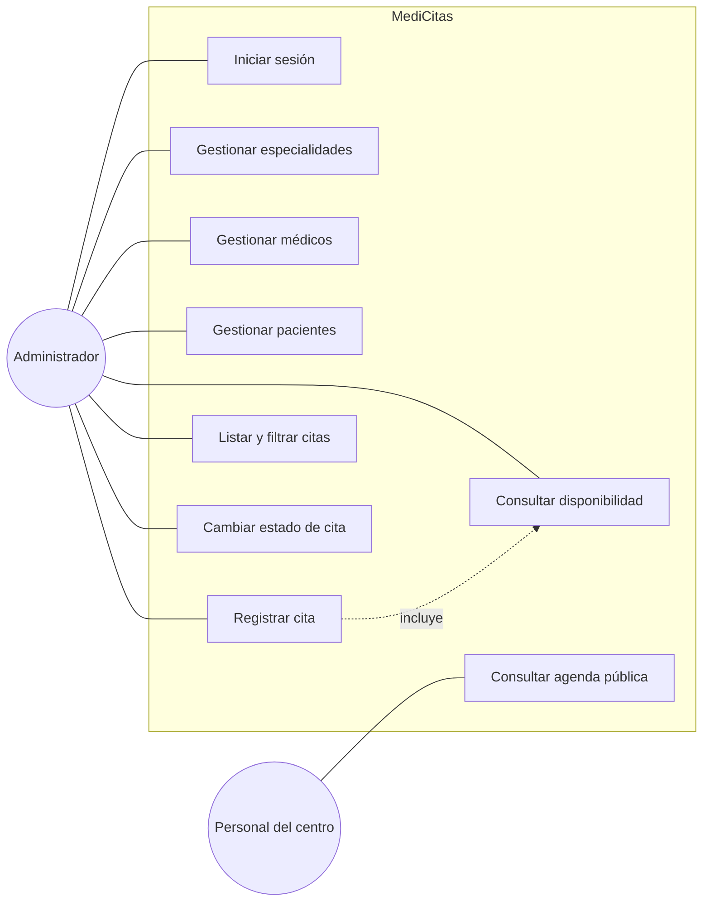
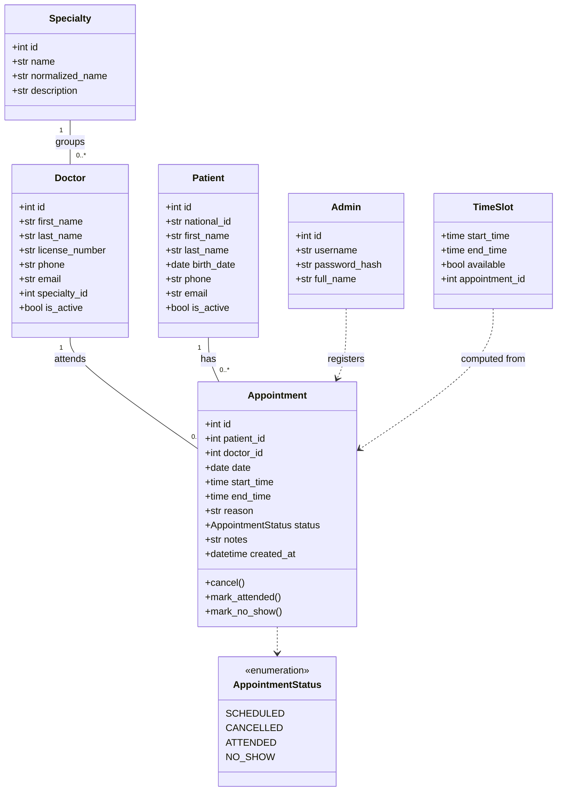
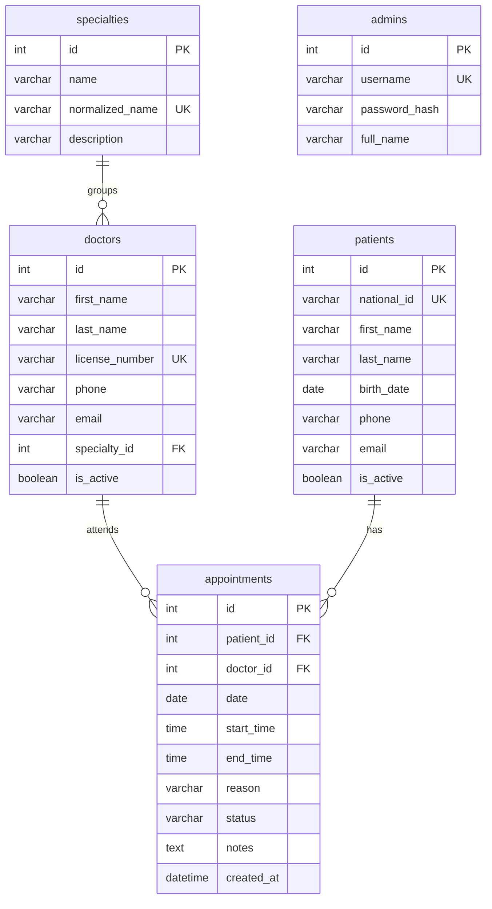

# MediCitas: Documento de diseño

## 1. Descripción del proyecto

MediCitas es una aplicación web para un centro médico con varias especialidades (medicina general, odontología, ginecología, psicología, etc.). Un único usuario administrador registra pacientes, médicos y citas. Los pacientes agendan por teléfono: el administrador consulta la disponibilidad del médico, el paciente elige un turno y la cita queda registrada.

Los médicos consultan sus citas en una **agenda pública** que no requiere inicio de sesión, pero que solo es accesible desde la red interna del centro médico.

**Problema que resuelve:** la gestión de citas en papel o en hojas de cálculo provoca turnos duplicados, citas olvidadas y falta de visibilidad para los médicos. MediCitas centraliza la agenda, valida los turnos automáticamente y la publica para el personal del centro.

**Actores:**
- **Administrador:** único usuario con acceso. Gestiona especialidades, médicos, pacientes y citas.
- **Personal del centro (médicos):** consultan la agenda pública desde la red interna. No inician sesión.

**Convención de nombres:** la documentación está en español, pero las clases, tablas, columnas, variables, endpoints y rutas del frontend se escriben en inglés.

## 2. Stack tecnológico

| Capa | Tecnología |
| --- | --- |
| Backend | Python 3.14, FastAPI, SQLAlchemy 2, Pydantic v2 |
| Base de datos | SQLite (archivo local) |
| Seguridad | JWT (PyJWT) para el administrador, contraseña con bcrypt |
| Frontend | HTML, CSS y JavaScript sin frameworks, servidos por el mismo FastAPI. Las páginas consumen la API con fetch(). |
| Dependencias | requirements.txt |

## 3. Horario de atención

Todos los médicos tienen el mismo horario fijo, definido en la configuración del sistema:

- Días: lunes a sábado. Los domingos no hay atención.
- Horario: 08:00 a 17:00, con pausa de almuerzo de 13:00 a 14:00 sin atención.
- Turnos de 30 minutos: 16 turnos por día (10 en la mañana, de 08:00 a 12:30, y 6 en la tarde, de 14:00 a 16:30).

Todas las fechas y horas se manejan en la zona horaria `America/Guayaquil`, configurable. Esta zona se usa para determinar la fecha actual, los turnos ya transcurridos y la expiración del token.

El médico permanece disponible en cada turno aunque no tenga cita asignada. Por eso los turnos no se guardan en la base de datos: se calculan a partir de la configuración y se cruzan con las citas registradas.

## 4. Requisitos funcionales

### RF-01

| Campo | Descripción |
| --- | --- |
| **Identificador** | RF-01 |
| **Nombre** | Inicio de sesión del administrador |
| **Descripción** | El sistema debe permitir que el administrador inicie sesión con su usuario y contraseña para acceder a las funciones de gestión. |
| **Prioridad** | Alta |
| **Criterios de aceptación** | <ul><li>El sistema permite el acceso solo cuando el usuario y la contraseña coinciden con los del administrador registrado.</li><li>El sistema muestra un mensaje de error claro cuando las credenciales son incorrectas.</li><li>La sesión expira automáticamente al superar el tiempo de validez definido en la configuración.</li><li>El administrador puede cerrar sesión manualmente.</li><li>Si se intenta acceder a una pantalla de gestión sin sesión activa, el sistema redirige al inicio de sesión.</li></ul> |

### RF-02

| Campo | Descripción |
| --- | --- |
| **Identificador** | RF-02 |
| **Nombre** | Gestión de especialidades |
| **Descripción** | El sistema debe permitir que el administrador cree, edite y liste las especialidades médicas del centro. |
| **Prioridad** | Media |
| **Criterios de aceptación** | <ul><li>El administrador puede crear una especialidad con nombre y descripción.</li><li>El nombre es obligatorio y no puede repetirse, sin distinguir mayúsculas, minúsculas ni tildes; si ya existe, el sistema muestra un mensaje de error.</li><li>El administrador puede editar el nombre y la descripción de una especialidad existente.</li><li>El sistema muestra el listado de todas las especialidades.</li><li>Las especialidades no se eliminan ni se desactivan.</li></ul> |

### RF-03

| Campo | Descripción |
| --- | --- |
| **Identificador** | RF-03 |
| **Nombre** | Gestión de médicos |
| **Descripción** | El sistema debe permitir que el administrador registre, edite, liste y desactive médicos, asignando a cada uno una especialidad. |
| **Prioridad** | Alta |
| **Criterios de aceptación** | <ul><li>El administrador puede registrar un médico con nombres, apellidos, número de registro profesional, teléfono, email y especialidad.</li><li>Nombres, apellidos, número de registro y especialidad son obligatorios.</li><li>El número de registro no puede repetirse; si ya existe, el sistema muestra un mensaje de error.</li><li>El administrador puede editar los datos de un médico existente. Al editar, el estado activo debe enviarse siempre de forma explícita, para evitar reactivar un médico sin querer.</li><li>El administrador puede desactivar y reactivar un médico. Los médicos no se eliminan, para conservar el historial de citas.</li><li>El sistema impide desactivar un médico que tenga citas futuras SCHEDULED y muestra un mensaje indicando cuántas tiene. Deben cancelarse primero.</li><li>El listado de médicos puede filtrarse por especialidad y por estado (activo o inactivo).</li></ul> |

### RF-04

| Campo | Descripción |
| --- | --- |
| **Identificador** | RF-04 |
| **Nombre** | Gestión de pacientes |
| **Descripción** | El sistema debe permitir que el administrador registre, edite, liste y desactive pacientes. |
| **Prioridad** | Alta |
| **Criterios de aceptación** | <ul><li>El administrador puede registrar un paciente con cédula, nombres, apellidos, fecha de nacimiento, teléfono y email.</li><li>Cédula, nombres, apellidos y teléfono son obligatorios.</li><li>La cédula no puede repetirse; si ya existe, el sistema muestra un mensaje de error.</li><li>La fecha de nacimiento no puede ser una fecha futura.</li><li>El administrador puede editar los datos de un paciente existente. Al editar, el estado activo debe enviarse siempre de forma explícita, para evitar reactivar un paciente sin querer.</li><li>El administrador puede desactivar y reactivar un paciente. Los pacientes no se eliminan, para conservar el historial de citas.</li><li>El sistema impide desactivar un paciente que tenga citas futuras SCHEDULED y muestra un mensaje indicando cuántas tiene. Deben cancelarse primero.</li></ul> |

### RF-05

| Campo | Descripción |
| --- | --- |
| **Identificador** | RF-05 |
| **Nombre** | Búsqueda de pacientes |
| **Descripción** | El sistema debe permitir que el administrador busque pacientes por cédula o por nombre. |
| **Prioridad** | Media |
| **Criterios de aceptación** | <ul><li>El sistema muestra un campo de búsqueda visible en la pantalla de pacientes y en el registro de citas.</li><li>El sistema lista los pacientes que coinciden total o parcialmente con el texto ingresado, evaluando cédula, nombres y apellidos.</li><li>Si no hay coincidencias, el sistema muestra un mensaje indicando que no se encontraron resultados.</li></ul> |

### RF-06

| Campo | Descripción |
| --- | --- |
| **Identificador** | RF-06 |
| **Nombre** | Consulta de disponibilidad |
| **Descripción** | El sistema debe permitir que el administrador consulte los turnos de un médico en una fecha, indicando cuáles están libres y cuáles ocupados. |
| **Prioridad** | Alta |
| **Criterios de aceptación** | <ul><li>El administrador selecciona un médico activo y una fecha.</li><li>El sistema muestra los 16 turnos de 30 minutos del día (08:00 a 12:30 y 14:00 a 16:30), indicando si cada uno está libre u ocupado.</li><li>El sistema no muestra turnos en la pausa de almuerzo (13:00 a 14:00).</li><li>Si la fecha es domingo, el sistema informa que no hay atención ese día.</li><li>Los turnos de fechas pasadas, o de horas ya transcurridas del día actual, se muestran como no disponibles.</li><li>Un turno está ocupado si tiene una cita en cualquier estado distinto de CANCELLED. Los turnos ocupados muestran el estado de la cita.</li><li>Un turno con una cita cancelada se muestra como libre.</li></ul> |

### RF-07

| Campo | Descripción |
| --- | --- |
| **Identificador** | RF-07 |
| **Nombre** | Registro de citas |
| **Descripción** | El sistema debe permitir que el administrador registre una cita seleccionando paciente, médico, fecha, turno libre y motivo. |
| **Prioridad** | Alta |
| **Criterios de aceptación** | <ul><li>El sistema solo ofrece para seleccionar pacientes y médicos activos.</li><li>El motivo de la cita es obligatorio.</li><li>El sistema solo acepta turnos válidos: de lunes a sábado, con inicio en hora o media hora, entre 08:00 y 12:30 o entre 14:00 y 16:30.</li><li>El sistema rechaza la cita si el médico ya tiene una cita no cancelada en ese turno.</li><li>El sistema rechaza la cita si el paciente ya tiene una cita no cancelada en la misma fecha y hora, aunque sea con otro médico.</li><li>Estas dos validaciones se garantizan también en la base de datos, de modo que dos registros simultáneos no puedan ocupar el mismo turno.</li><li>El sistema rechaza citas en fechas u horas pasadas.</li><li>El backend rechaza la cita si el paciente o el médico están desactivados, aunque la petición no venga de la interfaz.</li><li>La cita se crea con estado SCHEDULED y con hora de fin 30 minutos después de la hora de inicio.</li><li>El sistema muestra un mensaje de confirmación al registrar la cita, o un mensaje de error claro indicando el motivo del rechazo.</li></ul> |

### RF-08

| Campo | Descripción |
| --- | --- |
| **Identificador** | RF-08 |
| **Nombre** | Consulta y filtrado de citas |
| **Descripción** | El sistema debe permitir que el administrador liste las citas registradas y las filtre por médico, especialidad, paciente, fecha y estado. |
| **Prioridad** | Alta |
| **Criterios de aceptación** | <ul><li>El sistema muestra las citas ordenadas por fecha y hora.</li><li>Cada cita muestra fecha, hora, paciente, médico, especialidad, motivo y estado.</li><li>El administrador puede aplicar uno o varios filtros a la vez y el sistema muestra solo las citas que cumplen todas las condiciones.</li><li>El administrador puede limpiar los filtros y volver al listado completo.</li><li>Si no hay citas que cumplan los filtros, el sistema muestra un mensaje informativo.</li></ul> |

### RF-09

| Campo | Descripción |
| --- | --- |
| **Identificador** | RF-09 |
| **Nombre** | Actualización del estado de una cita |
| **Descripción** | El sistema debe permitir que el administrador cambie el estado de una cita (cancelada, atendida o no asistió) y agregue observaciones. |
| **Prioridad** | Alta |
| **Criterios de aceptación** | <ul><li>Solo se puede cambiar el estado de una cita SCHEDULED, hacia CANCELLED, ATTENDED o NO_SHOW.</li><li>Las citas CANCELLED, ATTENDED y NO_SHOW son estados finales y no pueden cambiar de estado.</li><li>Solo se puede marcar ATTENDED o NO_SHOW cuando ya llegó la hora de inicio de la cita.</li><li>Antes de cancelar, el sistema pide confirmación al administrador.</li><li>Al cancelar una cita, su turno vuelve a quedar libre.</li><li>El administrador puede agregar o editar observaciones de la cita en cualquier estado, incluidos los estados finales.</li><li>La actualización solo modifica el estado y las observaciones. Para cambiar fecha, médico o paciente se cancela la cita y se registra una nueva.</li></ul> |

### RF-10

| Campo | Descripción |
| --- | --- |
| **Identificador** | RF-10 |
| **Nombre** | Agenda pública |
| **Descripción** | El sistema debe permitir que el personal del centro consulte la agenda de citas sin iniciar sesión, filtrando por médico y fecha. |
| **Prioridad** | Alta |
| **Criterios de aceptación** | <ul><li>La agenda pública es la página principal y no requiere inicio de sesión.</li><li>Por defecto muestra las citas del día actual de todos los médicos.</li><li>El usuario puede filtrar por médico y por fecha.</li><li>Muestra solo las citas SCHEDULED, ordenadas por hora.</li><li>Cada cita muestra únicamente hora, médico, especialidad y nombre del paciente. No muestra cédula, teléfono, motivo ni observaciones.</li><li>Si la petición no proviene de una red interna configurada, el sistema responde con acceso denegado y la interfaz muestra un mensaje indicando que la agenda solo está disponible desde el centro médico.</li></ul> |

## 5. Requisitos no funcionales

### RNF-01

| Campo | Descripción |
| --- | --- |
| **Identificador** | RNF-01 |
| **Nombre** | Almacenamiento seguro de la contraseña |
| **Descripción** | El sistema debe almacenar la contraseña del administrador de forma segura. |
| **Categoría** | Seguridad |
| **Prioridad** | Alta |
| **Criterios de aceptación** | <ul><li>La contraseña se guarda con hash bcrypt y nunca en texto plano.</li><li>Al iniciar sesión, el sistema compara el hash y no recupera la contraseña original.</li></ul> |

### RNF-02

| Campo | Descripción |
| --- | --- |
| **Identificador** | RNF-02 |
| **Nombre** | Control de acceso |
| **Descripción** | El sistema debe proteger las funciones de gestión y restringir la agenda pública a la red del centro. |
| **Categoría** | Seguridad |
| **Prioridad** | Alta |
| **Criterios de aceptación** | <ul><li>Todos los endpoints de gestión requieren un token JWT válido; sin él responden con error 401.</li><li>La agenda pública solo responde a peticiones desde las redes configuradas como internas. Por defecto: 127.0.0.1, ::1, 10.0.0.0/8, 172.16.0.0/12 y 192.168.0.0/16.</li><li>La IP se obtiene directamente de la conexión; se ignoran cabeceras de proxy como X-Forwarded-For.</li><li>El frontend se sirve desde el mismo servidor que la API, por lo que no se requiere CORS y el backend recibe la IP real del navegador.</li></ul> |

### RNF-03

| Campo | Descripción |
| --- | --- |
| **Identificador** | RNF-03 |
| **Nombre** | Persistencia y datos de prueba |
| **Descripción** | El sistema debe conservar los datos entre reinicios y disponer de datos de ejemplo para pruebas. |
| **Categoría** | Fiabilidad |
| **Prioridad** | Alta |
| **Criterios de aceptación** | <ul><li>Los datos se guardan en un archivo SQLite y se mantienen al reiniciar la aplicación.</li><li>Al iniciar, el sistema crea el administrador con los datos de configuración solo si aún no existe.</li><li>Si la base de datos está vacía y la configuración lo permite, se cargan datos de prueba: 4 especialidades, 4 médicos, 5 pacientes y algunas citas. Reiniciar la aplicación no duplica los datos.</li></ul> |

### RNF-04

| Campo | Descripción |
| --- | --- |
| **Identificador** | RNF-04 |
| **Nombre** | Validación y manejo de errores |
| **Descripción** | El sistema debe validar los datos de entrada y responder con errores comprensibles. |
| **Categoría** | Fiabilidad |
| **Prioridad** | Alta |
| **Criterios de aceptación** | <ul><li>El backend valida todas las entradas con Pydantic.</li><li>Los errores se devuelven con un código HTTP adecuado y un mensaje claro en español, con el formato estándar de FastAPI: {"detail": "mensaje"}.</li><li>En los errores de validación (422) se devuelve un mensaje genérico indicando el campo con error. La validación detallada de cada campo la realiza el frontend.</li><li>Los listados no usan paginación, dado el volumen reducido de datos.</li><li>El frontend muestra esos mensajes al usuario en lugar de errores técnicos.</li></ul> |

### RNF-05

| Campo | Descripción |
| --- | --- |
| **Identificador** | RNF-05 |
| **Nombre** | Usabilidad |
| **Descripción** | La interfaz debe ser sencilla y estar pensada para computadoras de escritorio del centro médico. |
| **Categoría** | Usabilidad |
| **Prioridad** | Media |
| **Criterios de aceptación** | <ul><li>La interfaz se muestra en español.</li><li>Las pantallas están diseñadas para navegadores de escritorio, con una resolución mínima de 1280 px de ancho. No se contempla el uso en dispositivos móviles.</li><li>Los formularios indican los campos obligatorios y validan cada campo antes de enviar (obligatorio, longitud máxima, formato), descartando los espacios al inicio y al final, y muestran el error junto al campo correspondiente.</li><li>El backend repite estas validaciones como protección ante peticiones que no provengan del formulario.</li></ul> |

### RNF-06

| Campo | Descripción |
| --- | --- |
| **Identificador** | RNF-06 |
| **Nombre** | Mantenibilidad y documentación |
| **Descripción** | El código debe ser fácil de entender, configurar y ejecutar. |
| **Categoría** | Mantenibilidad |
| **Prioridad** | Media |
| **Criterios de aceptación** | <ul><li>Clases, tablas, columnas, variables, endpoints y rutas usan nombres en inglés.</li><li>El backend se organiza en capas: models, schemas, services y routers.</li><li>Días de atención, horario, pausa de almuerzo, duración del turno y redes internas son configurables en un archivo de configuración.</li><li>La API expone documentación automática en /docs (Swagger de FastAPI).</li><li>El repositorio incluye un README con instrucciones de instalación y ejecución local en Windows.</li></ul> |

## 6. Diagrama de casos de uso

## 7. Diagrama de clases

**Nota:** `TimeSlot` no es una tabla. Es una clase calculada que el servicio de disponibilidad genera a partir del horario configurado y de las citas no canceladas del médico en esa fecha.

## 8. Esquema de base de datos

**Notas del esquema:**
- `national_id` corresponde a la cédula del paciente y `license_number` al número de registro profesional del médico.
- `normalized_name` guarda el nombre de la especialidad en minúsculas, sin tildes y sin espacios al inicio o al final. Se calcula en Python al crear o editar, y su índice único garantiza que no haya nombres equivalentes. No se usan intercalaciones personalizadas de SQLite, para que la base pueda consultarse y editarse con herramientas externas.
- `status` se guarda como texto con los valores del enum `AppointmentStatus`.
- Las validaciones de turno ocupado (RF-07) se hacen en la capa de servicio y además se garantizan con dos índices únicos parciales de SQLite, que solo aplican a citas con `status` distinto de `CANCELLED`:
  - `(doctor_id, date, start_time)`: un médico no puede tener dos citas en el mismo turno.
  - `(patient_id, date, start_time)`: un paciente no puede tener dos citas a la misma hora.
  Así una cita cancelada no bloquea el turno y dos registros simultáneos no pueden duplicarlo.
- El administrador se crea al iniciar la aplicación con los datos del archivo de configuración.

## 9. API REST

| Método | Ruta | Acceso | Descripción |
| --- | --- | --- | --- |
| POST | /api/auth/login | Público | Recibe usuario y contraseña en JSON y devuelve token JWT del administrador (RF-01) |
| GET | /api/specialties | Admin | Lista especialidades (RF-02) |
| POST | /api/specialties | Admin | Crea especialidad (RF-02) |
| PUT | /api/specialties/{id} | Admin | Edita especialidad (RF-02) |
| GET | /api/doctors?specialty_id=&is_active= | Admin | Lista y filtra médicos (RF-03) |
| POST | /api/doctors | Admin | Crea médico (RF-03) |
| PUT | /api/doctors/{id} | Admin | Edita, desactiva o reactiva médico (RF-03) |
| GET | /api/doctors/{id}/availability?date= | Admin | Turnos libres y ocupados del día (RF-06) |
| GET | /api/patients?search=&is_active= | Admin | Lista y busca pacientes por cédula o nombre (RF-04, RF-05) |
| POST | /api/patients | Admin | Crea paciente (RF-04) |
| PUT | /api/patients/{id} | Admin | Edita, desactiva o reactiva paciente (RF-04) |
| GET | /api/appointments?doctor_id=&specialty_id=&patient_id=&date=&status= | Admin | Lista y filtra citas (RF-08) |
| POST | /api/appointments | Admin | Registra cita (RF-07) |
| PATCH | /api/appointments/{id} | Admin | Actualiza estado y observaciones (RF-09) |
| GET | /api/public-schedule?doctor_id=&date= | Red interna | Agenda pública sin datos sensibles (RF-10) |

## 10. Pantallas del frontend

Cada pantalla es una página HTML independiente servida por FastAPI.

| Pantalla | Página | Acceso |
| --- | --- | --- |
| Agenda pública | / (index.html) | Red interna, sin login |
| Login | /login.html | Público |
| Panel de citas | /admin/appointments.html | Admin |
| Nueva cita (paciente, médico, fecha y turnos) | /admin/new-appointment.html | Admin |
| Pacientes | /admin/patients.html | Admin |
| Médicos | /admin/doctors.html | Admin |
| Especialidades | /admin/specialties.html | Admin |

## 11. Arquitectura

**Organización general:** un solo proyecto, al estilo de una aplicación web clásica. El mismo servidor FastAPI expone la API REST bajo `/api` y sirve los archivos estáticos del frontend (HTML, CSS y JavaScript). Se arranca con un único comando y no requiere Node, npm ni CORS.

- `app/`: código Python del backend.
- `static/`: páginas HTML, hojas de estilo y scripts del frontend.
- `docs/`: documentación del proyecto (este diseño y la conversación completa con el asistente de IA).

En la raíz también van el `requirements.txt` y el `README.md` con las instrucciones de ejecución.

**Backend, arquitectura por capas:**

| Capa | Responsabilidad |
| --- | --- |
| models | Entidades de SQLAlchemy que representan las tablas. |
| schemas | Modelos de Pydantic para validar las entradas y dar forma a las respuestas. |
| services | Lógica de negocio: cálculo de turnos y validaciones de los criterios de aceptación. |
| routers | Endpoints de la API; reciben la petición, llaman al servicio y devuelven la respuesta. |

Además, el backend tiene módulos transversales para configuración, conexión a la base de datos, seguridad (JWT, bcrypt y restricción por red interna) y carga de datos de prueba.

**Frontend:** HTML, CSS y JavaScript sin frameworks ni herramientas de compilación. Una página HTML por pantalla, una hoja de estilos común y scripts de JavaScript con:

- Un módulo común para llamar a la API con `fetch()`, que agrega el token del administrador y muestra los mensajes de error.
- Un script por página con su lógica.
- El token JWT se guarda en `sessionStorage` tras el login. Las páginas de administración redirigen a `/login.html` si no hay token o si la API responde 401.

La estructura detallada de archivos se define durante la implementación, a partir de esta arquitectura.

## 12. Decisiones técnicas

**Configuración**
- El archivo `.env` (leído con pydantic-settings) contiene solo lo que cambia según la instalación: `SECRET_KEY`, `ADMIN_USERNAME`, `ADMIN_PASSWORD`, `ADMIN_FULL_NAME`, `JWT_EXPIRATION_MINUTES` (60 por defecto), `DATABASE_FILENAME`, `LOAD_SAMPLE_DATA` e `INTERNAL_NETWORKS`.
- `SECRET_KEY` y `ADMIN_PASSWORD` no tienen valor por defecto en el código: son obligatorias en el `.env`.
- Las reglas del negocio (zona horaria, días de atención, horario, almuerzo y duración del turno) son constantes en `app/config.py`, no variables de entorno.
- La ruta de la base de datos se resuelve siempre respecto a la raíz del proyecto, no a la carpeta desde donde se ejecute.

**Backend**
- SQLAlchemy 2 en modo síncrono.
- Contraseñas con el paquete `bcrypt` directamente, sin `passlib`.
- El login recibe JSON, por lo que no se usa `python-multipart`. Swagger se autoriza pegando el token (esquema Bearer).
- El token JWT se firma con HS256 y contiene solo `sub` (id del admin), `iat` y `exp`, en UTC.
- Al iniciar, el administrador se crea solo si no existe ningún administrador.
- Los datos de prueba se cargan solo si `LOAD_SAMPLE_DATA` es verdadero y no hay especialidades, médicos, pacientes ni citas (el admin no cuenta). Incluyen citas del día actual, algunas en horas ya transcurridas, y otras en los días de atención siguientes, siempre en turnos válidos.
- Un turno se considera transcurrido si su hora de inicio es menor o igual a la hora actual.
- Las reglas de transición de estado de una cita están en un solo lugar del código.

**Comportamiento de la API**
- Códigos HTTP: 404 para registros inexistentes; 409 para duplicados (usuario, especialidad, registro profesional, cédula), turno ocupado, paciente ocupado y desactivación con citas futuras; 400 para otras reglas de negocio (médico o paciente inactivo, transición de estado inválida); 401 para token ausente o inválido; 403 para la agenda pública fuera de la red interna; 422 para validación.
- La disponibilidad de un médico inactivo responde 400. Para un domingo responde 200 con la lista de turnos vacía.
- Cada turno de la disponibilidad incluye el estado de la cita cuando está ocupado.
- La agenda pública incluye hora de inicio y de fin de cada cita.
- La API devuelve los nombres y apellidos de médicos y pacientes por separado, también en citas y en la agenda pública. El frontend los muestra como "Apellidos Nombres", usando una única función común.
- Un PATCH de cita que envía el mismo estado que ya tiene se acepta sin cambios. Se puede cancelar una cita SCHEDULED aunque ya haya pasado su hora. El motivo no se puede editar.

**Frontend**
- Las observaciones de una cita se editan en un modal dentro de la pantalla de citas.
- El filtro por paciente de la pantalla de citas reutiliza el buscador de pacientes.

**Pruebas**
- No se usan pruebas automáticas. Las pruebas se hacen en puntos de control: cuando la aplicación arranca, en Swagger al completar cada grupo de endpoints, y en el navegador al completar cada pantalla.
